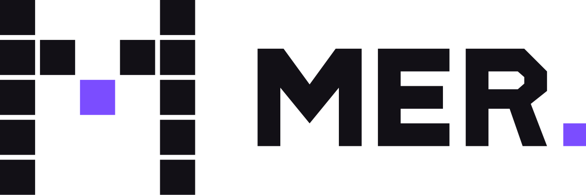
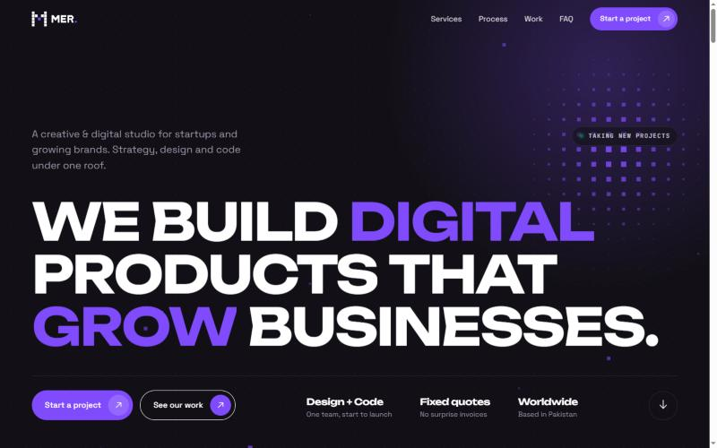
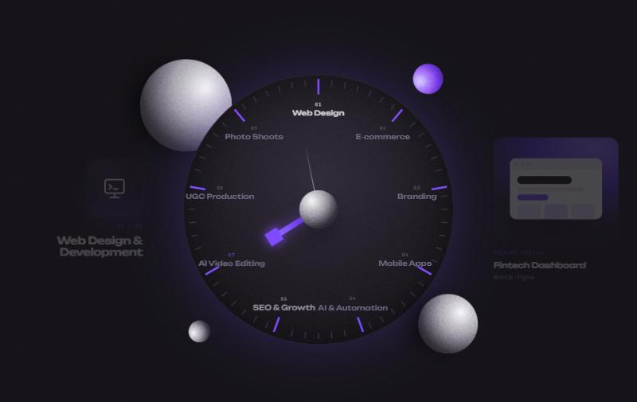
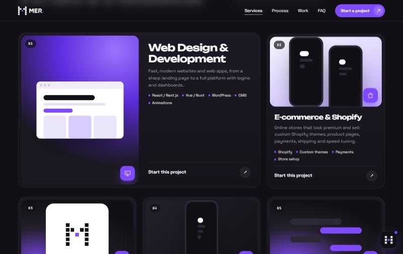
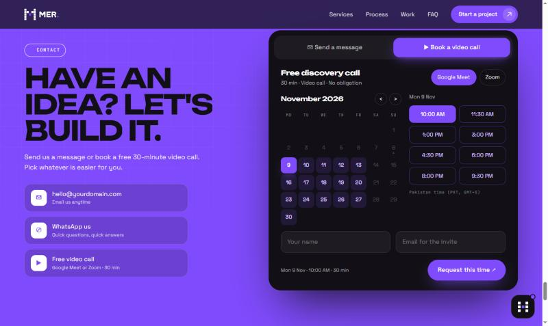
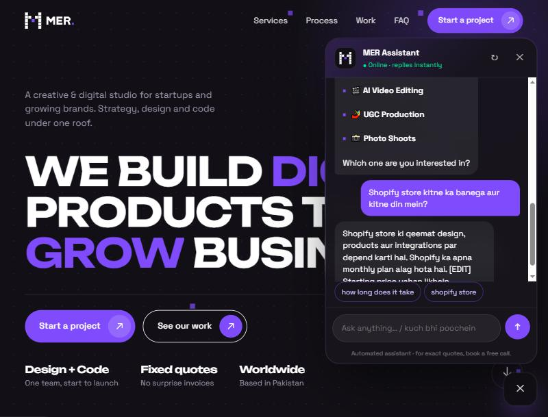
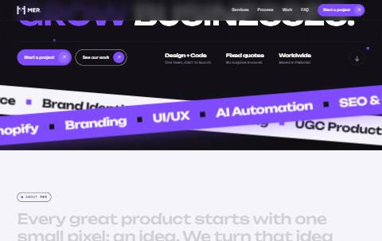
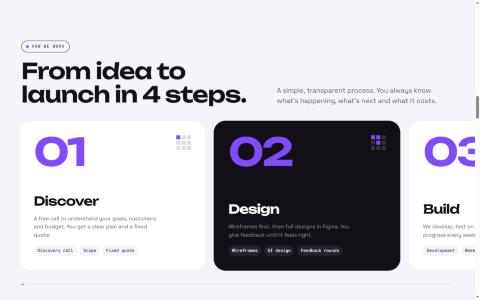
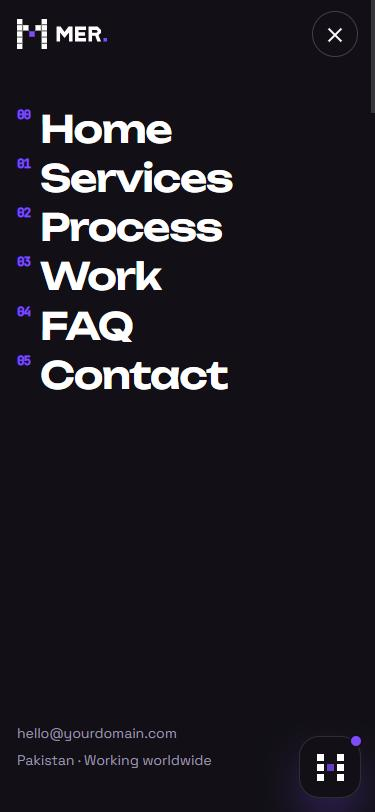
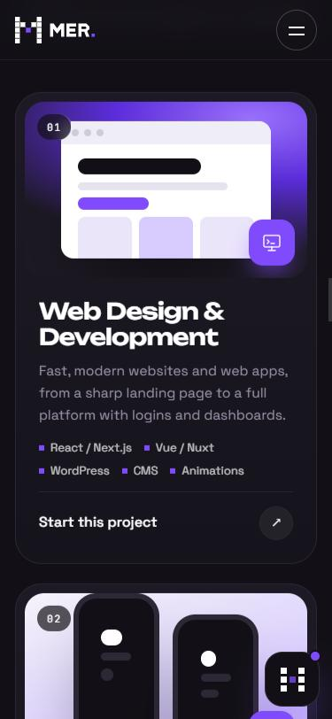

<p align="center">
  <picture>
    <source media="(prefers-color-scheme: dark)" srcset="docs/logo-dark-bg.png">
    
  </picture>
</p>

<h3 align="center">Creative &amp; Digital Studio website</h3>

<p align="center">
  A fast, animated, multi-page agency website with a services clock, video call booking<br>
  and an offline chatbot that answers 2,100+ questions. No build step, no server, no API key.
</p>

<p align="center">
  <a href="#-quick-start">Quick start</a> ·
  <a href="#%EF%B8%8F-edit-everything-in-one-file">Edit content</a> ·
  <a href="#-features">Features</a> ·
  <a href="#-put-it-online">Deploy</a> ·
  <a href="#-chatbot">Chatbot</a>
</p>

<p align="center">
  
  
  
  
  
</p>

---

<!-- After you publish the site, put the link here: -->
**🌐 Live site:** _add your link here (e.g. `https://your-username.github.io/mer-studio-website/`)_



## ✨ Features

- **7 pages:** Home, Services, Process, Work, FAQ, Contact, Terms, with a shared header, menu and footer
- **One content file:** change email, WhatsApp, services, projects or FAQs in `site-content.js` and every page updates
- **Animated preloader:** a 0 → 100 counter while the pixel "M" logo builds itself, square by square
- **Interactive hero:** a pixel field that lights up around the mouse, plus line-by-line text reveals
- **Crossing marquee bands:** two strips forming an "X", moving in opposite directions
- **Services clock:** the section pins while you scroll and the hand turns to each service, showing its icon on one side and a related project on the other
- **Horizontal process:** four steps that scroll sideways on desktop
- **Portfolio with filters:** projects grouped by websites, e-commerce, apps, branding, video and photo
- **Contact with video call booking:** send a message, or pick a day and time for a free Google Meet / Zoom call
- **Trust section:** promises, plus real stats, reviews and client names (shown only when filled in), and an optional founder note
- **Offline chatbot:** 2,100+ question phrasings in English and Roman Urdu, matched in the browser
- **Smooth everything:** Lenis smooth scrolling, GSAP ScrollTrigger animations, custom cursor, rolling-text buttons
- **Responsive:** designed mobile-first, with a full-screen mobile menu
- **Accessible extras:** respects "reduce motion", keyboard-friendly accordions and tabs

## 📸 Screenshots

| Services clock | Service cards |
|---|---|
|  |  |
| **Contact & video call booking** | **Chatbot** |
|  |  |
| **Crossing marquee** | **Process** |
|  |  |

<p align="center">
  
  &nbsp;&nbsp;
  
</p>

## 🚀 Quick start

The site is plain HTML, CSS and JavaScript, so there is nothing to install or build.

**Windows:** double-click **`START-WEBSITE.bat`**. Your browser opens http://localhost:8000.

**Mac / Linux:**

```bash
sh START-WEBSITE-mac-linux.sh
```

**Any computer with Python:**

```bash
python -m http.server 8000
```

Then open **http://localhost:8000**. Press `Ctrl + C` to stop.

> No Python? You can also just open `index.html` in your browser.
> An internet connection is needed for the fonts and animation libraries (loaded from CDN).

## ✏️ Edit everything in one file

All content lives in **`site-content.js`**. Open it in any text editor (even Notepad), change the text, save, and refresh the browser.

| Section | What it controls |
|---|---|
| `brand` | Name, tagline, slogan, description |
| `contact` | Email, WhatsApp, phone, city, working hours, reply time |
| `social` | Instagram, LinkedIn, Behance, Facebook, TikTok, YouTube (leave `""` to hide) |
| `settings` | Form email link, booking link (Cal.com / Calendly), "Taking new projects" badge |
| `menu` | Top navigation items |
| `services` | The services on the clock, Services page, contact form and chatbot |
| `process` | The 4 process steps |
| `projects` | Portfolio items (add `image: "assets/work/name.jpg"` for real screenshots) |
| `models` | Ways to work (fixed project, monthly, dedicated team) |
| `faq` | Questions and answers (FAQ page, home page and chatbot) |
| `stats` | Real numbers (projects, countries, rating), with a count-up animation. Hidden if empty |
| `testimonials` | Real client reviews. Hidden if empty |
| `clients` | Brand names as a moving strip. Hidden if empty |
| `founder` | A personal note with photo. Hidden until you add a name |
| `siteUrl` | Your public website address, used in share links |

Example: adding a project

```js
{ id: "bakery", title: "Bakery Website", category: "web", badge: "Website",
  meta: "Design · Development", tags: ["WordPress", "SEO"],
  link: "https://example.com", image: "assets/work/bakery.jpg", featured: true },
```

**Rules:** only change text inside `"quotes"`, keep the commas, and copy an existing `{ ... }` block to add a new item.

> ⚠️ This file is public on the website. Never put passwords or private keys in it.

## 🗂 Project structure

```
MER-Website/
├── index.html              Home
├── services.html           Services (clock + service cards + ways to work)
├── process.html            Process (4 steps + promises + FAQ)
├── work.html               Portfolio with filters
├── faq.html                All FAQs
├── contact.html            Contact form, video call booking, contact details
├── terms.html              Terms & privacy (template)
├── site-content.js         ← all website content (edit this)
├── START-WEBSITE.bat       One-click local start (Windows)
├── assets/
│   ├── css/style.css       Design system (colors & fonts at the top, under :root)
│   ├── js/render.js        Builds header, footer and lists from site-content.js
│   ├── js/main.js          Animations, preloader, clock, forms, booking
│   ├── js/chatbot.js       Chat widget + matching engine
│   ├── js/kb/              Chatbot knowledge base (5 files)
│   └── brand/              Logo, favicons, social images
├── docs/                   README images
├── hero-3d.html            Design preview: 3D hero (Three.js), not linked in the menu
├── hero-concepts.html      Design preview: hero ideas, not linked in the menu
└── contact-concepts.html   Design preview: contact ideas, not linked in the menu
```

## 💬 Chatbot

The chat widget (bottom right on every page) needs **no API key and no server**. It answers from a knowledge base of **2,100+ question phrasings across ~250 topics**, in English and Roman Urdu, matched instantly in the visitor's browser (TF-IDF + fuzzy matching, so it handles typos too). Nothing the visitor types is sent anywhere.

Its knowledge lives in `assets/js/kb/`, and it also reads your services, projects and FAQs from `site-content.js` automatically. Each topic looks like this:

```text
## price-website
q: how much does a website cost | website price | website kitne ka banega
a: The English answer.
ur: Roman Urdu answer (optional).
```

Lines marked **`[EDIT]`** are placeholders. Replace them with your real details before going live.

## 📅 Contact form & video call booking

- **Messages:** add a free [Formspree](https://formspree.io) form link to `settings.formEndpoint` to receive messages by email. Left empty, the form opens the visitor's email app.
- **Video calls:** create a 30-minute event on [Cal.com](https://cal.com) or [Calendly](https://calendly.com) connected to your Google Calendar, and paste the link into `settings.bookingUrl`. Visitors then get real calendar invites with a Google Meet / Zoom link. Left empty, booking requests are emailed to you.

## 🌍 Put it online

Any static host works. All features, including the chatbot, run without a server.

**GitHub Pages (free):**
1. Push this repository to GitHub.
2. Go to **Settings → Pages**.
3. Under **Build and deployment**, choose **Deploy from a branch**, branch **`main`**, folder **`/ (root)`**, then **Save**.
4. After a minute your site is live at `https://<username>.github.io/<repo-name>/`.

**Netlify:** drag and drop this folder at [app.netlify.com/drop](https://app.netlify.com/drop).
**Vercel / Cloudflare Pages:** import the repository; no build command and no output folder needed.

## 🎨 Customise the design

Colors and fonts are CSS variables at the top of `assets/css/style.css`:

```css
:root {
  --purple: #7B4DFF;   /* main accent */
  --night:  #121016;   /* dark background */
  --paper:  #F6F4FB;   /* light sections */
  --f-display: "Unbounded", system-ui, sans-serif;
  --f-body: "Space Grotesk", system-ui, sans-serif;
}
```

| Color | Hex | Use |
|---|---|---|
| Core Purple | `#7B4DFF` | Buttons, highlights, accents |
| Night | `#121016` | Dark backgrounds |
| Panel | `#1C1923` | Cards on dark |
| Paper | `#F6F4FB` | Light sections |
| Muted | `#9A94AA` | Secondary text |

## ✅ Before going live

- [ ] Replace email, WhatsApp and phone in `site-content.js`
- [ ] Add your social links
- [ ] Replace the sample projects with real ones (and add screenshots in `assets/work/`)
- [ ] Fill in every `[EDIT]` line in `assets/js/kb/` (prices, payment methods, team size…)
- [ ] Add your Formspree and Cal.com / Calendly links
- [ ] Review `terms.html` (it's a template, not legal advice)
- [ ] Check FAQ promises (timelines, reply time, ownership) match how you work

## 🛠 Built with

- HTML, CSS and vanilla JavaScript (no framework, no build step)
- [GSAP](https://gsap.com) + ScrollTrigger for animations
- [Lenis](https://lenis.darkroom.engineering) for smooth scrolling
- [Three.js](https://threejs.org) in the 3D hero preview
- Google Fonts: Unbounded, Space Grotesk, JetBrains Mono

## 📄 License

© MER. All rights reserved. The code, design and brand assets in this repository belong to MER.

<p align="center"><b>MER</b> · Small pixels. Big ideas.</p>
